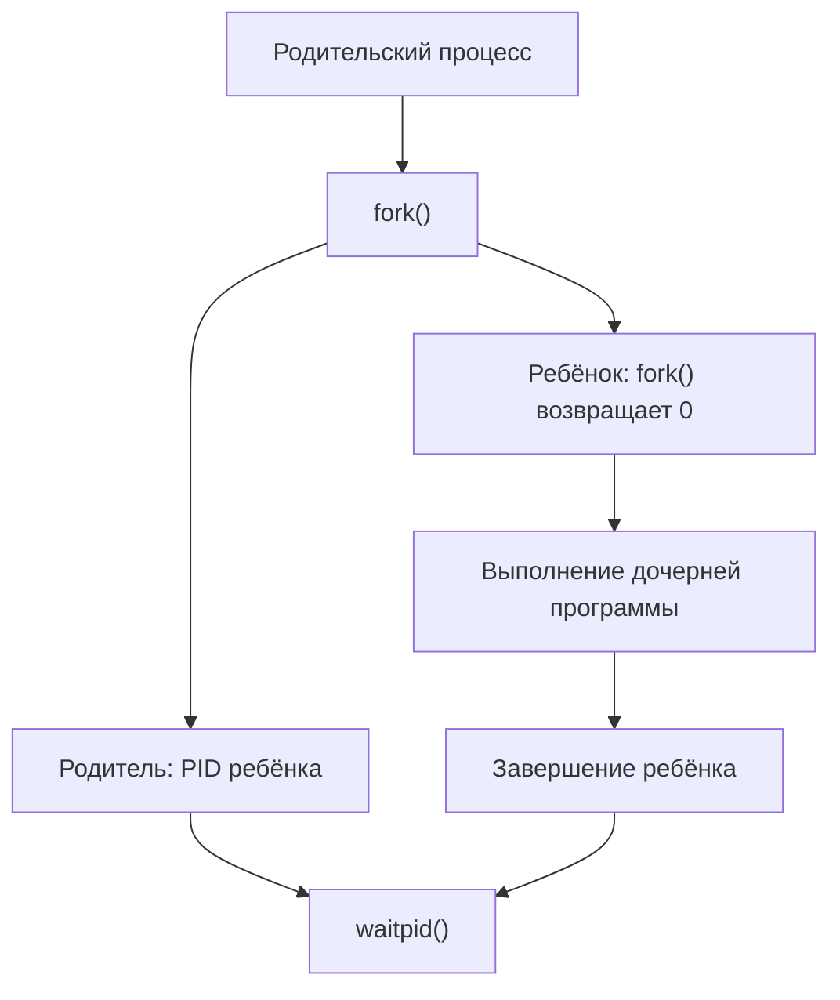
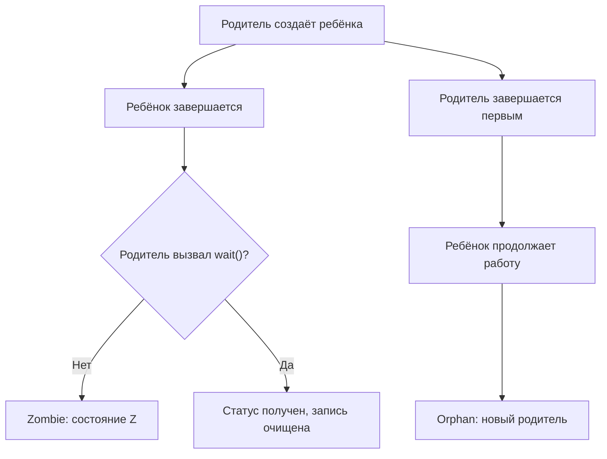
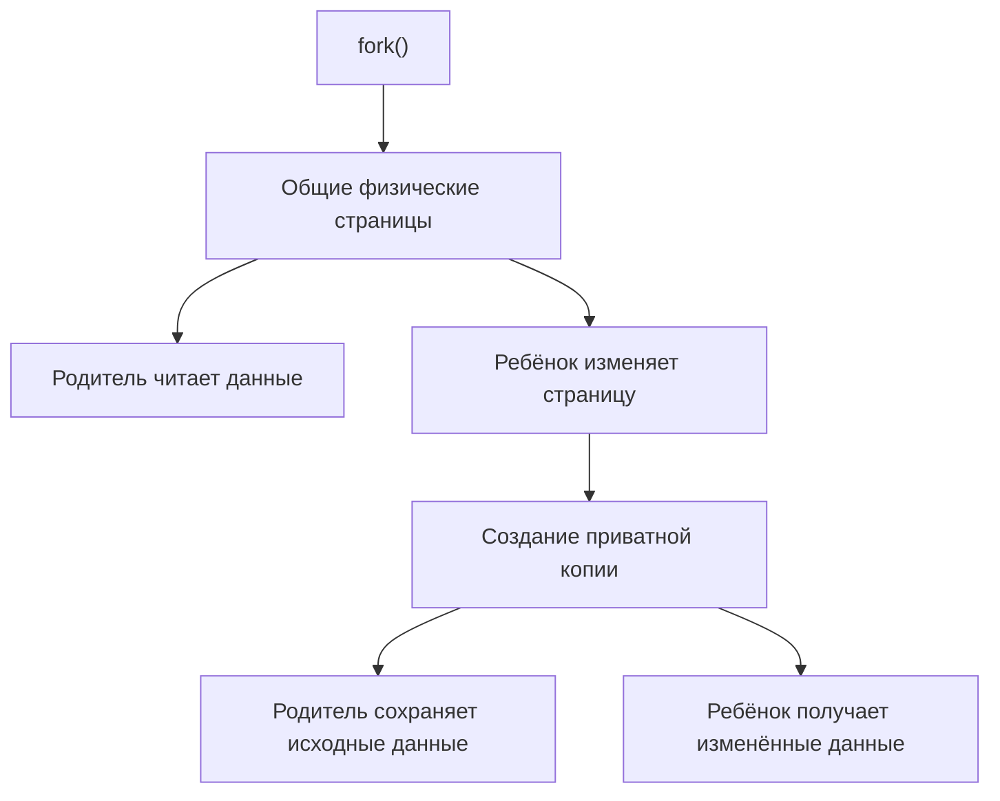

cat > README.md <<'EOF'
# OS-Project-3 — Процессы в Linux


Практическая работа № 3 по дисциплине «Проектирование операционных систем».

**Уровень:** вариант B  
**Среда выполнения:** Ubuntu в WSL2  
**Язык программирования:** Python  
**Основные темы:** процессы, `fork()`, `exec()`, `waitpid()`, `/proc`, Zombie, Orphan, Copy-on-Write.

---

## Содержание

1. [Цель работы](#1-цель-работы)
2. [Задачи варианта B](#2-задачи-варианта-b)
3. [Структура проекта](#3-структура-проекта)
4. [Требования и подготовка окружения](#4-требования-и-подготовка-окружения)
5. [Теоретические сведения](#5-теоретические-сведения)
6. [Реализация программ](#6-реализация-программ)
7. [Результаты экспериментов](#7-результаты-экспериментов)
8. [Тестирование](#8-тестирование)
9. [Проблемы и ограничения](#9-проблемы-и-ограничения)
10. [Вывод](#10-вывод)

---

## 1. Цель работы

Изучить управление процессами в операционной системе Linux и исследовать основные механизмы создания, выполнения и завершения процессов.

В ходе работы рассматриваются:

- получение информации о процессах через файловую систему `/proc`;
- создание дочерних процессов с помощью `fork()`;
- запуск программ через `exec()`;
- ожидание завершения процессов с помощью `waitpid()`;
- состояния Zombie и Orphan;
- механизм Copy-on-Write при создании дочернего процесса;
- измерение использования памяти процессами.

## 2. Задачи варианта B

| № | Задача | Файл |
|---|---|---|
| 1 | Построить дерево процессов текущего пользователя из `/proc` | `ptree.py` |
| 2 | Создать N дочерних процессов, запускать команды через `exec`, измерять время и получать коды завершения | `runner.py` |
| 3 | Продемонстрировать Zombie и Orphan | `zombie.py`, `orphan.py` |
| 4 | Исследовать Copy-on-Write и изменение RSS | `cow_demo.py` |

Все программы запускаются отдельно из терминала Ubuntu.

## 3. Структура проекта

```text
OS-Project-3/
├── ptree.py
├── runner.py
├── zombie.py
├── orphan.py
├── cow_demo.py
├── README.md
└── .gitignore
```

### Назначение файлов

**`ptree.py`** — читает данные о процессах из `/proc` и показывает PID, состояние и использование резидентной памяти RSS.

**`runner.py`** — создаёт дочерние процессы с помощью `fork()`, запускает переданную команду посредством `execvp()` и получает код завершения.

**`zombie.py`** — демонстрирует ситуацию, когда дочерний процесс завершился, но родитель ещё не забрал его статус через `waitpid()`.

**`orphan.py`** — показывает, что происходит с дочерним процессом после завершения родителя.

**`cow_demo.py`** — выделяет память, создаёт дочерний процесс и сравнивает статистику памяти до и после изменения страниц.

## 4. Требования и подготовка окружения

Для выполнения работы необходимы:

- Ubuntu Linux или Ubuntu в WSL2;
- Python 3;
- доступ к `/proc`;
- терминал;
- VS Code (необязательно, но используется для редактирования файлов);
- Git для последующей загрузки проекта на GitHub.

### Проверка окружения

```bash
python3 --version
git --version
pwd
```

Перейти в каталог проекта:

```bash
cd ~/OS-Project-3
```

## 5. Теоретические сведения

### 5.1. Что такое процесс

Процесс — это выполняющийся экземпляр программы. У каждого процесса есть идентификатор PID, состояние, адресное пространство и другие характеристики.

В Linux информация о процессах доступна через виртуальную файловую систему `/proc`.

Например:

```bash
cat /proc/self/status
ps -eo pid,ppid,stat,cmd
```

Основные поля:

| Поле | Значение |
|---|---|
| PID | Идентификатор процесса |
| PPID | Идентификатор родительского процесса |
| STAT | Состояние процесса |
| RSS | Объём резидентной памяти |
| VmRSS | Использование резидентной памяти согласно `/proc` |

### 5.2. Создание процесса

В Linux системный вызов `fork()` создаёт дочерний процесс на основе вызывающего процесса.



После `fork()` родитель и ребёнок продолжают выполнение независимо. В обычной модели Linux их виртуальные адресные пространства логически независимы, даже если физические страницы временно общие.

### 5.3. Запуск программы через exec

Функции семейства `exec()` заменяют программу внутри текущего процесса другой программой. Новый PID при этом не создаётся.

В проекте используется `os.execvp()`.

Последовательность:

1. Родитель вызывает `fork()`.
2. Ребёнок вызывает `execvp()`.
3. Операционная система загружает указанную программу.
4. Родитель ожидает завершения ребёнка через `waitpid()`.

### 5.4. Zombie и Orphan

**Zombie** — уже завершившийся процесс, запись о котором сохраняется до получения родителем статуса завершения.

**Orphan** — процесс, родитель которого завершился раньше него. Такой процесс переназначается соответствующему процессу-усыновителю.



Zombie и Orphan — разные состояния жизненного цикла процессов. Зомби уже завершился, а сирота продолжает выполняться.

### 5.5. Copy-on-Write

Copy-on-Write (CoW) — механизм, при котором после `fork()` физические страницы памяти могут совместно использоваться родителем и ребёнком, пока один из них не попытается изменить страницу.

При записи операционная система создаёт отдельную копию соответствующей страницы.



Для исследования памяти используются показатели из `/proc/self/smaps_rollup`:

- `Rss` — резидентная память процесса;
- `Pss` — пропорционально распределённая резидентная память;
- `Private_Dirty` — приватные изменённые страницы;
- `Shared_Dirty` — общие изменённые страницы.

Эти значения зависят от окружения, поэтому результаты могут отличаться при повторном запуске.

## 6. Реализация программ

### 6.1. Дерево процессов — `ptree.py`

Запуск:

```bash
python3 ptree.py
```

Программа перебирает числовые каталоги `/proc`, читает `status`, извлекает сведения о процессах и строит дерево по PID и PPID.

Ожидаемый формат вывода:

```text
└── systemd (PID=350, State=S (sleeping), RSS=11316 kB)
    └── (sd-pam) (PID=351, State=S (sleeping), RSS=3580 kB)
└── bash (PID=552, State=S (sleeping), RSS=5312 kB)
    └── python3 (PID=938, State=R (running), RSS=11672 kB)
```

Это пример формата, а не фиксированный результат. PID и использование памяти меняются между запусками.

### 6.2. Запуск дочерних процессов — `runner.py`

Команда:

```bash
python3 runner.py -n 3 -- /bin/echo Hello from child
```

Параметр `-n 3` задаёт три запуска команды.

Полученный результат:

```text
Hello from child
Child 1: PID=1004, exit_code=0, time=0.013s
Hello from child
Child 2: PID=1005, exit_code=0, time=0.001s
Hello from child
Child 3: PID=1006, exit_code=0, time=0.001s
```

Все три дочерних процесса завершились успешно с кодом `0`.

Проверка обработки ошибки запуска:

```bash
python3 runner.py -n 2 -- /nonexistent-command
```

Для отсутствующей команды ожидается код завершения `127`.

### 6.3. Процесс-зомби — `zombie.py`

Запуск:

```bash
python3 zombie.py
```

Программа создаёт дочерний процесс, который завершается сразу. Родитель временно ожидает 20 секунд, прежде чем вызвать `waitpid()`.

Во время ожидания в другом терминале можно проверить состояние ребёнка:

```bash
ps -o pid,ppid,stat,cmd -p PID_РЕБЁНКА
```

Вместо `PID_РЕБЁНКА` необходимо указать фактический PID из вывода программы.

Буква `Z` в поле `STAT` означает состояние Zombie. После вызова `waitpid()` родителем запись о зомби должна исчезнуть.

### 6.4. Процесс-сирота — `orphan.py`

Запуск:

```bash
python3 orphan.py
```

Программа создаёт дочерний процесс, после чего родитель завершается. Ребёнок продолжает выполняться и выводит свой новый PPID.

Пример фактического вывода:

```text
Parent PID=1052, child PID=1053
Parent exits; child will continue running.
Child PID=1053, new PPID=550
Orphan demonstration finished.
```

В этом запуске дочерний процесс получил нового родителя с PID `550`. Конкретный PID зависит от системы.

### 6.5. Copy-on-Write — `cow_demo.py`

Запуск:

```bash
python3 cow_demo.py
```

Программа выделяет массив размером 64 MiB, обращается к каждой странице, создаёт ребёнка через `fork()` и изменяет страницы в дочернем процессе.

Измерения производятся через `/proc/self/smaps_rollup`.

В конце программа проверяет, что первый байт родительского массива по-прежнему равен `1`.

## 7. Результаты экспериментов

### 7.1. Проверка `runner.py`

| Показатель | Результат |
|---|---|
| Число запусков | 3 |
| Успешные завершения | 3 |
| Код завершения | 0 |
| Вывод команды | `Hello from child` |

### 7.2. Измерение памяти при Copy-on-Write

Выполненный запуск `cow_demo.py` дал следующие результаты для дочернего процесса:

| Показатель | До изменения | После изменения |
|---|---:|---:|
| RSS | 73308 kB | 73364 kB |
| PSS | 36082 kB | 68893 kB |
| Private_Dirty | 604 kB | 66188 kB |
| Shared_Dirty | 68912 kB | 3328 kB |

Наиболее заметное изменение — рост `Private_Dirty` с 604 kB до 66188 kB.

Это согласуется с механизмом Copy-on-Write: после записи в страницы память становится приватной для дочернего процесса.

RSS почти не изменился, поскольку этот показатель учитывает и общие, и приватные резидентные страницы.

### 7.3. Проверка независимости памяти

После завершения ребёнка программа вывела:

```text
Child exit code: 0
Parent data at first byte: 1
Expected value: 1
```

Исходное значение родительского массива сохранилось.

### 7.4. Итоговая таблица проверки

| Программа | Проверяемый результат |
|---|---|
| `ptree.py` | Вывод процессов из `/proc` |
| `runner.py` | PID, код завершения, время выполнения |
| `zombie.py` | Ожидание родителем и сбор завершившегося ребёнка |
| `orphan.py` | Продолжение работы ребёнка после завершения родителя |
| `cow_demo.py` | Изменение статистики памяти и независимость данных |

Результаты `ptree.py`, `zombie.py` и `orphan.py` следует проверять непосредственно во время выполнения: состояния процессов и PID динамические.

## 8. Тестирование

Из каталога проекта можно проверить синтаксис всех программ:

```bash
python3 -m py_compile ptree.py runner.py zombie.py orphan.py cow_demo.py
```

Если команда не вывела ошибок, синтаксическая проверка прошла успешно.

Затем выполнить основные проверки:

```bash
python3 ptree.py
python3 runner.py -n 3 -- /bin/echo Hello from child
python3 zombie.py
python3 orphan.py
python3 cow_demo.py
```

Для `zombie.py` необходимо проверить состояние ребёнка в течение периода ожидания родителя. Для `orphan.py` необходимо обратить внимание на изменение PPID.

## 9. Проблемы и ограничения

1. **PID динамические.** Нельзя ожидать одинаковых PID при каждом запуске.
2. **RSS и PSS изменяются.** На результаты влияют системные процессы, библиотеки и особенности WSL.
3. **Zombie существует ограниченное время.** Если родитель быстро вызовет `waitpid()`, состояние `Z` можно не успеть увидеть.
4. **Orphan не обязательно получает PPID 1.** Новый родитель зависит от настроек и поведения среды Linux.
5. **CoW исследуется экспериментально.** Измерения памяти подтверждают поведение механизма, но не являются универсальными значениями для любой системы.

## 10. Вывод

В ходе практической работы изучены основные механизмы управления процессами в Linux.

Реализованы программы для просмотра дерева процессов, запуска дочерних процессов, демонстрации Zombie и Orphan, а также исследования Copy-on-Write.

Эксперимент с Copy-on-Write показал увеличение приватной изменённой памяти дочернего процесса после записи в страницы. При этом исходные данные родителя остались неизменными.

Таким образом, работа помогла изучить создание процессов, выполнение программ, получение статуса завершения, жизненный цикл процессов и особенности управления памятью в Linux.

---

**Проект:** OS-Project-3  
**Практическая работа:** № 3  
**Вариант:** B
EOF

cat > .gitignore <<'EOF'
__pycache__/
*.py[cod]
.venv/
venv/
.env
EOF
